# Namesake

**Namesake's AI writes accurate adoption listings for shelter animals, offers screened name options, and plans where to get each animal seen, using Qloo taste data near the shelter.**

**Live demo:** https://namesake.bogdansabau.eu. Nothing to install, sign up for or pay: it runs on the author's Qloo key and model accounts, with the usage caps lifted for judging.

**Try it:** open one of the five "Read a finished story" links (instant), then run one live: pick an animal and an area and watch the step log (about a minute). On the result, switch Generic / Local, open "How Namesake made this" and the Why drawer to see what Qloo returned apart from what the AI did with it, refine with a line such as "other names", then edit and approve or print a flyer. Type your own shelter area or add your own animal; a new area takes a few minutes, since Qloo calls are spaced 2 seconds apart.

A volunteer picks an animal and the shelter's area. In about a minute Namesake produces:

1. **A listing written only from the facts the shelter recorded.** Plain words, third person, behaviour toward people first. A bite history or guarding is always stated. Code checks each sentence of the bio against the record and sends back content words the facts don't contain.
2. **Name options drawn from Qloo taste data**, each labelled with where it came from and screened for villains, violent or tragic characters (well-known animals that die in their story among them), aggression words, words that put an animal down, real people and identity-coded references, never from a title whose own name would sound wrong in a listing, and never what another animal at the shelter is named after.
3. **A plan to get the animal seen**: the evidence-backed channels (foster networks, outings, timing) plus a few local venues that fans of pet-themed shows and films favour, each with Qloo's evidence beside it.

A **generic version** of the listing sits beside the **local version**, so you can see exactly what Qloo adds. Every Qloo answer is shown apart from how Namesake read it.

Built for the [Qloo Agentic Hackathon](https://qloo-hackathon.devpost.com/). Taste data from the Qloo API; not affiliated with Qloo.


The whole result page, with the map, the places to ask and "How Namesake made this": [`docs/img/result.png`](docs/img/result.png).

## The problem

US shelters and rescues took in about **5.8 million dogs and cats in 2025** ([Shelter Animals Count](https://www.shelteranimalscount.org/2025-report/)). Intake is falling; the pressure is animals that stay. **Large dogs** are 26% of dog intake but 22% of dog adoptions, and wait about **70% longer** than small dogs before adoption ([Hill's 2026](https://theaawa.org/wp-content/uploads/2026/03/Hills-Shelter-Report-2026.pdf)). New York's city shelter system passed **1,000 animals in care** in July 2025 and suspended general intake ([NY1](https://ny1.com/nyc/all-boroughs/news/2025/07/21/animal-care-centers-of-nyc-suspend-intakes-at-shelters)); its largest exit for dogs is transfer to rescue partners, not direct adoption ([ACC 2025](https://www.nycacc.org/wp-content/uploads/2026/01/ACC-2025-EOY-SAC.pdf)).

Volunteers write listings for every one of those animals, often with little time. AI bio writers are free and common, but none has published outcome evidence, and a documented complaint about one is that it adds a fake backstory ([evidence review](docs/research/adoption-evidence-review.md)). That matters: in a cohort of about 4,500 UK adopters, owners who found a dog **more work than expected had 9.9 times the odds of returning it** ([Diesel 2008](https://pubmed.ncbi.nlm.nih.gov/18243374/)). A warm listing that guesses at traits opens exactly that gap.

What the research does and does not support shaped the design ([full review](docs/research/adoption-evidence-review.md)):

- **Accuracy first.** Real-outcome studies favour plain, factual, third-person text, and measured wording effects are about 1 to 3 days. So the bio is drafted only from recorded facts, and code checks each of its sentences against them.
- **Names do no harm.** No study shows that a name speeds adoption. One found a penalty for Black-perceived names on pit-bull-type dogs ([Quadlin & Montgomery 2022](https://journals.sagepub.com/doi/10.1177/01902725221090900)). So names are screened, with the strictest screen for bully-breed dogs, and the volunteer chooses.
- **Exposure is where the associations are large.** Being seen in person and through foster carers' own networks shows the biggest (observational) effects. So the plan leads with those.
- **Taste targeting is untested.** Nobody has tested whether locally resonant names or taste-targeted venues help. Namesake treats that layer as a labelled experiment and records what a trial would need.

Namesake does **not** claim to get animals adopted faster, save lives or money, or match animals to adopters.

## How it uses Qloo

The same dog, the same record, two neighbourhoods of one city. Park Slope offers Space, Scooby and Dug; Astoria offers Bluey, Rin Tin Tin and Scooby. The local name comes from a pet-themed title Qloo ranks in each area (Space from *Dogs in Space*, Bluey from *Bluey*); the other options come from the area's pet-themed titles (Rin Tin Tin) or from lookalike titles Namesake's AI proposed and found in Qloo (Scooby from *Scooby-Doo* in both areas, Dug from *Up*).


Namesake's AI (two agents, one per area and one per animal) and some plain code call Qloo through the official harness (`qloo exec`, pinned at 0.1.26). Every call is cached in SQLite and spaced at least 2 seconds apart, because the hackathon key is rate-limited; a refused ranking is retried after a longer wait.

Who decides each step, from the area to the result (the same graph is in [`docs/architecture.md`](docs/architecture.md)):

```mermaid
flowchart TD
    area(["The shelter's area and the animal's record"]) --> tastes
    tastes["The area's top TV shows:<br/>recommend with the area"]:::qloo --> lists
    lists["Lists for the area, asked with Qloo's pet tags:<br/>recommend, before the AI runs"]:::qloo --> sort1
    sort1["Sort each title: kept, unsure or set aside"]:::jev --> judge
    judge["Judge the unsure titles, add up to four of its own"]:::ai --> lookup
    lookup["Look its own titles up: describe"]:::qloo --> pick
    pick{"Ambiguous name?"}:::ai -- "choose a candidate, with a reason" --> search
    pick -- no --> search
    search["What fans here also like, as the AI asks:<br/>recommend with a title and the area"]:::qloo --> sort2
    sort2["Sort the results the same way"]:::jev --> rank
    rank["Order the titles for the area, as the AI asks: rank"]:::qloo --> evidence
    evidence["Keep only titles Qloo ranks or lists here,<br/>when any has that (else the AI's own, said so);<br/>pick the venue and map titles by that evidence"]:::code --> venues
    venues["Places near the shelter for their fans,<br/>in kinds that can host a stand:<br/>recommend place"]:::qloo --> compare
    compare["Compare with the places for the area's top shows<br/>(recommend place, as code asks it)"]:::code --> choose
    choose["Pick up to three places for an event or a flyer"]:::ai --> check
    check{"Every title and place from Qloo,<br/>screens passed, evidence kept?"}:::code -- "no, once" --> judge
    check -- yes --> maps
    maps["Heatmaps within the area: where_popular"]:::qloo --> lift
    lift["Lift against the top shows; a thin first map gives way"]:::code --> lookalike
    lookalike["Up to two lookalike titles, as the AI asks:<br/>describe"]:::qloo --> listing
    listing["Names from the pet titles and the area's top shows,<br/>and the bio from the record"]:::ai --> screen
    screen{"Facts traced, names screened,<br/>no shared name or reference, length?"}:::code -- "no, once" --> listing
    screen -- yes --> audience
    audience["Who tends to like each name's title, for the volunteer to read:<br/>audience_demographics"]:::qloo --> pins
    pins["After the run: place the suggested venues not yet tried,<br/>with OpenStreetMap, and keep the points"]:::code --> page(["The result: Qloo's part and the AI's, kept apart"])

    classDef qloo fill:#fbe3d9,stroke:#a84526,color:#3a1a10
    classDef jev fill:#ece6f6,stroke:#6a4c93,color:#2a1d3d
    classDef ai fill:#e1efe4,stroke:#3d6b4a,color:#173020
    classDef code fill:#e8e8e8,stroke:#555555,color:#222222
```



Colours: **Qloo** answers (terracotta), **the classifier**, TypeSafe's Jev (violet), **Namesake's AI** decides (green), **plain code** decides the same way every time (grey).

| What | Qloo workflow | Who decides | Why |
|---|---|---|---|
| Pet-themed titles people around the area tend to like | `recommend` TV, films and books with Qloo's four pet tags as signals plus `signal_location`, 20 each | Code asks, before the AI does anything; a classifier ([TypeSafe's Jev](https://typesafe.ai)) marks which are about pets; **Namesake's AI** judges the unsure ones | As filters the pet tags left two shows and no films; as signals with the area they gave 3 to 8 pet titles in each of four areas probed on 18 October ([findings](docs/qloo-findings.md)). These are the AI's main titles. |
| Titles Namesake's AI adds | `describe` | **Namesake's AI** may add up to four well-known titles, picks among Qloo's candidates with a stated reason, or drops a title; code keeps one only if Qloo ranks it here or lists it for the area, when any title has that evidence (else the AI's own stay, and the page says so) | Bluey and PAW Patrol never appear in the tag lists, so the AI may propose them, but its say-so is not evidence. 6 of 10 show names came back ambiguous. |
| More pet titles strong in the area | `recommend` TV, films or books with one of its pet titles as the signal plus `signal_location`: what people around the area who like it also like | **Namesake's AI** chooses the title and the kinds, up to three searches; the classifier sorts the results the same way, and the AI judges the unsure ones | In one recorded run for Austin, the two titles Qloo ranked for the area, Bluey and Nature Cat, both came from these lists, not from the AI's own ideas; in a probe for Barcelona, the AI's US-known titles mostly had no ranking at all ([findings](docs/qloo-findings.md)). The page shows each found title's place in Qloo's list and the classifier's scores, apart from each other. |
| Order the titles for this area | `rank` with `signal_location` | **Namesake's AI**, once per area, Qloo's titles and its own together | A title the ranking leaves out is not ranked here. When Qloo's ranking is unavailable, the titles found in the area's lists lead, and the page says so. |
| Places near the shelter that fans favour | `recommend`, `target_type: place`, titles as signals, `include_tags` for kinds of place that can host a stand | Code sends the three of the AI's kept titles with the strongest evidence for the area (Qloo's ranking, else their place in the area's lists), titles about another animal only last (a cat show is not a dog's venue signal while a dog or pet title has evidence), and asks only for cafes and breweries, bookshops and pet shops, and community places (each group in for a reason the page gives; arenas, bars, gyms, restaurants and hotels left out), both lists the same way; **Namesake's AI** picks up to three venues for a flyer or event, each with a reason: among suitable places near the top or middle of Qloo's list, those that stand out against the area's top shows first (code sends back a plan that skips them without a reason), then the rest by rank, never a listed national chain, and asked to pass over fast food; code then leaves out a place OpenStreetMap puts more than 5 km from the shelter (the cards stay in Qloo's order) | Without the kinds, Qloo's places near a spot are mostly what is popular there (an arena, axe throwing) whatever the titles; with them, cafes, a brewery and a bookshop near Park Slope. The places are the area's, the same for every animal of that species there, and the page says so. |
| A baseline to compare against | `recommend` TV with `signal_location` for the area's top shows, leaving out any whose name or description mentions animals, a religion, race or politics; then `recommend` places for their fans | Code | With one unrelated show (*Yellowstone*) as the baseline, 9 of the first 15 venues for the pet-themed titles also came back for it: they are just popular nearby. The baseline is now what the area itself watches most, so "stands out" means "for fans of pet-themed titles more than for this area's usual tastes". Each venue shows its rank and whether it stands out. |
| A map of how fans of pet-themed titles compare | `where_popular` within the neighbourhood, for the two pet titles the venues were asked for first (by evidence, titles about another animal last) and the top two baseline shows; a first pet title with fewer than five cells there gives way once to the next, when that makes a better map (more cells with a comparison) | Code | Raw affinity saturates near 1.0, so the map shows **lift**: the pet titles' cell score minus the baseline shows', each averaged over the maps that scored the cell and then ranked again among the cells scored for both, since Qloo ranks each title over its own cells. A key on the map says what the colours mean, and the caption counts the cells fans of pet-themed titles rank higher than fans of the area's top shows do, and says that compares parts of the area, not how many fans live there (no count on a thin map of fewer than five cells, or with one cell or none to compare). |
| What the area tends to watch | `recommend` TV shows with `signal_location` | Code | A second, labelled source of name options. |
| Titles with an animal that looks like this one | `describe` | **Namesake's AI**, per animal, at most two | A personal name option: Qloo's line says only that it found the title (or offered it among candidates, when it asked which was meant), and the lookalike match is on the line of Namesake's AI. The shared look must be quoted from the animal's record as whole phrases ("brindle coat", not "short"). |
| Who tends to like each name's title | `audience_demographics` with the title's ID, once per title (cached) | Code, after the listing is written. Shown only: it plays no part in choosing names | With each name option (beside it, or under "Why these names?" in the default skin), where Qloo shows a clear lean: "Fans of Bluey lean toward ages 35 to 44 (+0.19) and 45 to 54 (+0.35), and are more often women (+0.16), across all of Qloo's audiences". Qloo's skew from −1 to +1 against its average audience, only leans of +0.15 or more, worded about the title's fans, never the area or a person. Titles differ: *My Cat from Hell* leans 55 and over, *Dogs in Space* under 25. Asked of the area and of venues, Qloo had nothing for Park Slope and only patchy leans for places, so neither is shown ([findings](docs/qloo-findings.md)). |
| A volunteer types their own area, or right-clicks the shelter's spot on the map (in the story and warm skins, a search above the map moves it to any city first) | `recommend` for the area's own top TV show, then `where_popular` for that show within the area's name (a widely watched seed show as well when the list is not a plain answer or its show is thin there) | Code | Five or more cells: accepted, and the map centres on them. Fewer: "too little data here". Passing says Qloo has data for the area; when its pet titles still map thinly, the result page says so. Checked when an animal is picked, as the run's first step; `needs_input` becomes candidate buttons on the working page. A bare name Qloo resolves on its own, such as "Portland", passes with no candidates and nothing saying which place Qloo read; the page then shows the place Qloo's data centres on as OpenStreetMap names it ("Portland, Oregon"), and in the story skin the step log of the run that named the area says Qloo did not say which. A spot picked on the map becomes the area's name before Qloo sees it (suggestions and names from OpenStreetMap via Photon); the spot itself is a pin for that visit only. |

The decisions behind each row, with their evidence, are in [`docs/decisions.md`](docs/decisions.md) and [`docs/qloo-findings.md`](docs/qloo-findings.md).

**What makes it an agent.** Namesake's AI is a model with Qloo tools. It starts from the pet-themed titles Qloo lists for the area and judges the unclear ones; it chooses which titles of its own to try, which titles to search the area's lists with and which of the titles found there are about pets, which venues suit an adoption event, and, for each animal, which lookalike titles to check. It reads each answer and adapts: an ambiguous title gets a choice or is dropped, an unavailable ranking falls back to its own order, a refused lookup is tried again with whole phrases quoted from the record's look. Calls that never change, such as the area's pet-themed lists, the baseline and the heatmaps, run in plain code, and code keeps a title only with Qloo's evidence for the area whenever any title has it.

**What a classifier does.** Titles in the area's lists are sorted by TypeSafe's Jev, a classifier that answers yes-or-no questions with a probability: are pets central, is it about dogs, cats or real people, does it suit a family audience. It reads only the title, its kind and Qloo's description. Code keeps the clear pet titles and sets aside the clear others; the rest go to Namesake's AI. Without a `TYPESAFE_API_KEY` the classifier is off and the AI judges them all.

**What plain code checks.** Every title and venue Namesake's AI returns must have come from Qloo in that run; invented IDs are sent back. Every bio sentence must cite recorded facts and use no content word they lack, and every recorded fact other than the look must be used. The check works on content words: it catches added traits and claims, not every shade of meaning, and small linking words such as "always" or "enjoys" pass. That is why the volunteer edits and approves. The hook line is assembled by code from the name, its role and Qloo's title, so the model writes none of it beyond the character's name. Picked places are never a listed national chain, nor a place found more than 5 km from the shelter. Names pass the screen. No two animals at a shelter share a name or what a name refers to (a title's character), except that a litter named as a set shares one title, and one animal's options come from different titles while another of the area's open titles is unused (lookalikes never count). A name's reason may use only the record's look words (or say the name is short and easy to say), never temperament, so a cultural reference never implies how the animal behaves. A failed check gets one repair round, then the templated listing, which says why.

## From request to result

1. **Start.** Pick one of twelve fictional animals, or the litter of four kittens, or add your own animal, kept in a workspace in your browser for 7 days, with a link to open it elsewhere and no sign-up. Pick a shelter area: Park Slope or Astoria in New York, Austin, Barcelona, or type one.
2. **Working.** A live log streams each step: Qloo's pet-themed lists for the area, titles proposed, each one looked up in Qloo, which were ambiguous and how they were settled, the venues found and how many stand out against the baseline, and the checks on the answer from Namesake's AI.
3. **Result**, legible as one screen, told as the animal's story:
   - a **Generic / Local, with Qloo** toggle whose buttons show each version's name; both share the same bio, and the local one adds a name from Qloo's titles and one line saying where it comes from. The button says "Local" only when Qloo's data for the area backs the name's title; otherwise it reads **With Qloo**, and the headline says the title was found but not in Qloo's data for the area
   - the **name options**, each with its Qloo title under it, and one line saying what in the result came from Qloo's data for the area ("the titles behind the names, 3 places to ask and the map"; it counts only names whose titles have Qloo's evidence for the area, and under the generic version names only the places and the map)
   - the **introduction**, the listing written from the shelter's records
   - a **map** of how fans of pet-themed titles compare within the area, and the **places to ask**, under a two-sentence note on what Qloo was asked for and what is left out (the reasons for each kind, and the fast-food rule, one click away), each with Qloo's rank first ("2nd of 15 · near the top of Qloo's list"), then the reason Namesake's AI gives and, one click away under "Why this place", Qloo's description and its comparison with the baseline on one Qloo line, numbered on the map, with the cell it sits in and its distance from the shelter (points from OpenStreetMap)
   - the **other ways to help**, each labelled Research, Qloo or Our suggestion; for an animal recorded as not good with children, places whose name or Qloo description mentions children are skipped, and the list says so; for one whose record says busy, noisy places are hard, the outing or event becomes "skip busy events", quoting the record
   - **How Namesake made this**, after the places: **Qloo's part and the AI's**, apart (what Qloo returned for this result, and what Namesake's AI did with it: the titles it searched Qloo's lists with, titles it proposed or judged, places it picked, the names and bio); the facts, Qloo's local context, and the interpretation and checks; the saved run's own step log, folded, each step marked Qloo, Namesake's AI, Classifier or Code; for each name what Qloo returned beside what Namesake's AI picked, folded; a **Why** drawer with two columns, "Qloo returned" (the Qloo calls behind the result) and "How Namesake read it" (Namesake's AI and its code); and the trial the local version would need

   ![The Park Slope result's "Help her story travel" band: the map of how fans of pet-themed titles compare with fans of the area's top shows, with its key, the dashed circle around the sample shelter and the places numbered; and the three places to ask, each with Qloo's rank first, then the reason Namesake's AI gives and, folded under 'Why this place', Qloo's description and Namesake's reading; under them, Namesake's two-sentence note on the kinds of place Qloo was asked for and what is left out, with the reasons folded under 'How these places were chosen'](docs/img/result-map.png)

   The `warm` and `classic` skins show the same listing, names, map, places and Why panel with Qloo's part and the AI's at the top, without story's "How Namesake made this" framing, the saved run's step log or the button that starts a run.
4. **Refine** with one line ("shorter sentences" keeps the names, "other names" changes them), **edit**, **approve**, and copy a block ready to paste into shelter software, or **print a flyer** with a checklist of the places to ask. A result with no listing yet also offers "Write her story with Namesake's AI" (for a member of a litter, naming the litter as a set).

The area's Qloo work runs once per area and species and is shared by every animal there, so a new area costs about 18 to 20 Qloo calls: one more when the venues must be asked again, fewer when titles are already cached, and two or three more to check a typed area first. Each further animal costs at most two.

## Measuring whether it works

The local layer is an experiment, and nobody has run the trial. Namesake records what one needs: each approval keeps the animal, the area, the variant (generic or local), the chosen name and its source, whether the volunteer edited the text, and the time. The trial it enables:

- **Design:** randomise generic against local at intake, so volunteers don't steer the appealing animals.
- **Primary outcome:** days from availability to adoption, analysed as time-to-event.
- **Safety outcomes:** returns within 30 and 90 days, and total shelter adoptions, to check that spotlighting one animal isn't taking adopters from another.
- **Size:** about 190 adoptions to detect a 50% faster adoption rate, about 630 for 25%, before allowing for clustering by shelter ([Schoenfeld 1983](https://doi.org/10.2307/2531021)). One small rescue can't answer it; a network could.

The hackathon build records the data; it does not run the trial.

## Run it locally

Needs Python 3.12 with [uv](https://docs.astral.sh/uv/), Node 22.19+ with the Qloo harness, a Qloo hackathon key, and an OpenAI-compatible model endpoint.

```sh
git clone https://github.com/bsabau/namesake && cd namesake
npm install -g @qloo/qloo-harness@0.1.26
cp .env.example .env      # fill in QLOO_API_KEY and the four AGENT_* values (fallbacks optional)
uv sync
uv run uvicorn app.main:app --reload
```

Open http://localhost:8000. A fresh clone has an empty cache, so the first run for an area calls Qloo live (about 18 to 20 calls, under two minutes with the spacing) and the model: a few minutes in all. To fill the cache for the start page's examples, or to watch one run in the terminal:

```sh
uv run python scripts/precompute_examples.py          # live: Qloo and the model
uv run python scripts/precompute_examples.py --all    # every preset animal in every area (--dry-run lists it)
uv run python scripts/run_agent.py dog-02 park-slope  # one run, steps printed
```

Set `ALLOW_LIVE_QLOO=false` to use only the cache. The model is configuration only (`AGENT_BASE_URL`, `AGENT_API_KEY`, `AGENT_MODEL`, `AGENT_API`), with up to two fallbacks (`AGENT_FALLBACK_1_*`, `AGENT_FALLBACK_2_*`) that a run starts again on when it cannot reach the model before (decision 25). The demo runs Muse Spark through [OpenCode Go](https://opencode.ai), then Claude Opus 5.5, then DeepSeek Flash; `scripts/run_agent.py --model 1` runs one model alone.

The same data is served as JSON (`/api/start`, `/api/results/dog-02@park-slope`, and the live step log at `/api/runs/{id}/events`), and `?ui=<name>` switches between interfaces in `app/ui/` (`story`, the default, which tells the result as a story; `warm`, the default before it; or `classic`, the first skin).

Tests never call Qloo or a model; they use hand-written envelopes with invented IDs:

```sh
uv run pytest
uv run ruff check . && uv run ruff format --check .
```

## Run it with Docker

```sh
docker build -t namesake .
docker run --rm -p 8000:8000 --env-file .env -v namesake-var:/app/var namesake
```

The cache lives in the Docker volume `namesake-var`, which the app's user owns.

The image holds Python, Node and the pinned harness. The demo runs this image on a long-lived VM behind Caddy, with the cache on a private volume; [`deploy/`](deploy/) has the compose file and the deploy script.

## Known limitations

- **No outcome evidence yet.** The tool is built to measure whether local taste data helps, and nothing has been measured.
- **Coverage is uneven.** The demo uses New York and Austin, where US coverage is deepest, and Barcelona, to test whether it holds outside the US. Thin areas are refused with a message instead of answered weakly.
- **Affinity scores saturate.** Raw scores sit near 1.0 for broad entities, so Namesake uses order within a call and lift against the area's own top shows, never raw affinity. The baseline is the area's own top two shows, so "stands out" means "more than this area's usual tastes", not more than everyone's.
- **Places by distance.** A place more than 5 km from the shelter is left out only once OpenStreetMap has pinned it. One it cannot find, or finds only more than 12 km away (read as another place of that name), keeps its place on the list, without a distance.
- **US-centred screens.** The list of national chains left out is mostly American, and the plan's research items come from US shelter studies; the posting-time item, the one that states a measured figure, says so on the page. The screen for venues that mention children reads English, Spanish and Catalan words.
- **Ranking is often unavailable.** Qloo's `rank` is the most rate-limited workflow and twice returned nothing; the order Namesake's AI chose is then kept and labelled.
- **Venues have no coordinates in Qloo.** Qloo returns an address and a neighbourhood, so the app looks each suggested venue up in OpenStreetMap (Photon) once; a venue with no close match stays in the list without a pin, and a pin outside the mapped cells says so.
- **Area data says nothing about individuals.** Results read "people in this area tend to like X". A shelter's adopters are not its neighbours, and tastes can stand in for demographics, which is one reason names are screened for identity-coded references.
- **The demo's first model is a coding-plan model.** Muse Spark through OpenCode Go sometimes needs its one repair round; when it cannot be reached, a run starts again on Claude Opus 5.5, then DeepSeek Flash. Each model judges lookalikes from its own knowledge, which Qloo cannot check; the page labels that match as the reading of Namesake's AI.

## Repository

How it works inside, with diagrams: [`docs/architecture.md`](docs/architecture.md).

| Path | What |
|---|---|
| `app/agent/` | the two PydanticAI agents (area profile, listing), their Qloo tools, the plain-code checks, the run pipeline |
| `app/qloo/` | the typed wrapper around `qloo exec`: envelope parsing, cache, spacing, replay |
| `app/views/`, `app/ui/story/` | view models (also served as JSON) and the default interface, which tells the result as a story; `app/ui/warm/` (the default before it, `?ui=warm`) and `app/ui/classic/` (the first skin, `?ui=classic`) are kept for comparison |
| `docs/` | [architecture](docs/architecture.md), [decisions](docs/decisions.md), [Qloo findings](docs/qloo-findings.md), [product design](docs/product.md), [evidence review](docs/research/adoption-evidence-review.md) |
| `tests/` | over 700 tests, all offline; `tests/test_no_qloo_data.py` keeps Qloo data out of the repo |

Qloo's terms forbid publishing its response data, so real responses live only in the git-ignored `var/` and the deployed cache.

## Credits

Taste data from the Qloo API. This project is not affiliated with or endorsed by Qloo.

The animals and the shelter are fictional, and the photos are AI-generated. Map tiles and place names © OpenStreetMap contributors (the story skin's basemaps © OpenStreetMap contributors © CARTO when a `MAP_TILES_KEY` is set); place lookups and venue pins by Photon (komoot). Pet-themed titles are sorted with [TypeSafe](https://typesafe.ai)'s Jev classifier, which receives only a title's name, kind and Qloo's description; Namesake is not affiliated with TypeSafe. The typefaces are Nunito and, in the story skin, Fraunces, served from the app itself under the SIL Open Font License (`app/ui/warm/static/fonts/OFL.txt`, `app/ui/story/static/fonts/`).

## Licence

[MIT](LICENSE)
