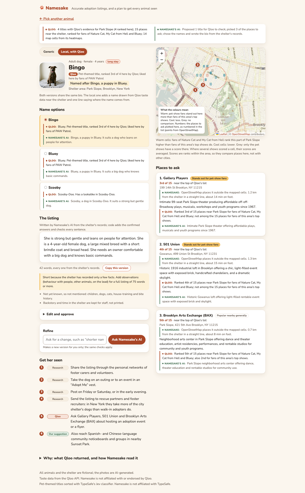

# Namesake

**Namesake's AI writes accurate adoption listings for shelter animals, offers screened name options, and plans where to get each animal seen, using Qloo taste data near the shelter.**

**Live demo:** https://namesake.bogdansabau.eu (the four "Try an example" links open instantly)

A volunteer picks an animal and the shelter's area. In about a minute Namesake produces:

1. **A listing written only from the facts the shelter recorded.** Plain words, third person, behaviour toward people first. A bite history or guarding is always stated. Code checks each sentence of the bio against the record and sends back content words the facts don't contain.
2. **Name options drawn from Qloo taste data**, each labelled with where it came from and screened for villains, violent or tragic characters, aggression words, real people and identity-coded references.
3. **A plan to get the animal seen**: the evidence-backed channels (foster networks, outings, timing) plus a few local venues that fans of pet-themed shows and films favour, each with Qloo's evidence beside it.

A **generic version** of the listing sits beside the **local version**, so you can see exactly what Qloo adds. Every Qloo answer is shown apart from how Namesake read it.

Built for the [Qloo Agentic Hackathon](https://qloo-hackathon.devpost.com/). Taste data from the Qloo API; not affiliated with Qloo.



## The problem

US shelters and rescues took in about **5.8 million dogs and cats in 2025** ([Shelter Animals Count](https://www.shelteranimalscount.org/2025-report/)). Intake is falling; the pressure is animals that stay. **Large dogs** are 26% of dog intake but 22% of dog adoptions, and wait about **70% longer** than small dogs before adoption ([Hill's 2026](https://theaawa.org/wp-content/uploads/2026/03/Hills-Shelter-Report-2026.pdf)). New York's city shelter system passed **1,000 animals in care** in July 2025 and suspended general intake ([NY1](https://ny1.com/nyc/all-boroughs/news/2025/07/21/animal-care-centers-of-nyc-suspend-intakes-at-shelters)); its largest exit for dogs is transfer to rescue partners, not direct adoption ([ACC 2025](https://www.nycacc.org/wp-content/uploads/2026/01/ACC-2025-EOY-SAC.pdf)).

Volunteers write listings for every one of those animals, often with little time. AI bio writers are free and common, but none has published outcome evidence, and a documented complaint about one is that it adds a fake backstory ([evidence review](docs/research/adoption-evidence-review.md)). That matters: in a cohort of about 4,500 UK adopters, owners who found a dog **more work than expected had 9.9 times the odds of returning it** ([Diesel 2008](https://pubmed.ncbi.nlm.nih.gov/18243374/)). A warm listing that guesses at traits opens exactly that gap.

What the research does and does not support shaped the design ([full review](docs/research/adoption-evidence-review.md)):

- **Accuracy first.** Real-outcome studies favour plain, factual, third-person text, and measured wording effects are about 1 to 3 days. So the bio is drafted only from recorded facts, and code checks each of its sentences against them.
- **Names do no harm.** No study shows that a name speeds adoption. One found a penalty for Black-perceived names on pit-bull-type dogs ([Quadlin & Montgomery 2022](https://journals.sagepub.com/doi/10.1177/01902725221090900)). So names are screened, with the strictest screen for bully-breed dogs, and the volunteer chooses.
- **Exposure is where the associations are large.** Being seen in person and through foster carers' own networks shows the biggest (observational) effects. So the plan leads with those.
- **Taste targeting is untested.** Nobody has tested whether locally resonant names or taste-targeted venues help. Namesake treats that layer as a labelled experiment and records what a trial would need.

Namesake does **not** claim to get animals adopted faster, save lives or money, or match animals to adopters.

## How it uses Qloo

Namesake's AI (two agents, one per area and one per animal) and some plain code call Qloo through the official harness (`qloo exec`, pinned at 0.1.26). Every call is cached in SQLite and spaced at least 5 seconds apart, because the hackathon key is rate-limited; a refused ranking is retried after a longer wait.

| What | Qloo workflow | Who decides | Why |
|---|---|---|---|
| Resolve the pet-themed titles Namesake's AI proposes | `describe` | **Namesake's AI** proposes 4 to 6 titles, picks among Qloo's candidates with a stated reason, or drops a title | Pet tags filter TV and film down to almost nothing, so the model proposes titles and Qloo checks them. 6 of 10 show names came back ambiguous. |
| Pet titles already strong in the area | `recommend` TV, films or books with one of its pet titles as the signal plus `signal_location`: what people around the area who like it also like | **Namesake's AI** chooses the title and the kinds, up to three searches; a classifier ([TypeSafe's Jev](https://typesafe.ai)) marks which results are about pets, and the AI judges the unsure ones | In one recorded run for Austin, the two titles Qloo ranked for the area, Bluey and Nature Cat, both came from these lists, not from the AI's own ideas; in a probe for Barcelona, the AI's US-known titles mostly had no ranking at all ([findings](docs/qloo-findings.md)). The page shows each found title's place in Qloo's list and the classifier's scores, apart from each other. |
| Order the titles for this area | `rank` with `signal_location` | **Namesake's AI**, once per area, its own titles and the ones found locally together | When Qloo's ranking is unavailable, the order Namesake's AI chose is kept and the page says so. |
| Places near the shelter that fans favour | `recommend`, `target_type: place`, titles as signals | **Namesake's AI** chooses which titles to send, then picks up to three venues for a flyer or event, with a reason | Fans of two pet shows give 15 venues in and around Park Slope. |
| A baseline to compare against | `recommend` TV with `signal_location` for the area's top shows, leaving out any whose name or description mentions animals, a religion, race or politics; then `recommend` places for their fans | Code | With one unrelated show (*Yellowstone*) as the baseline, 9 of the first 15 pet-show venues also came back for it: they are just popular nearby. The baseline is now what the area itself watches most, so "stands out" means "for pet-show fans more than for this area's usual tastes". Each venue shows its rank and whether it stands out. |
| A map of where pet-show fans stand out | `where_popular` within the neighbourhood, for the top two pet titles and the top two baseline shows | Code | Raw affinity saturates near 1.0, so the map shows **lift**: the pet titles' cell score minus the baseline shows', each averaged over the maps that scored the cell. A key on the map says what the colours mean. |
| What the area tends to watch | `recommend` TV and films with `signal_location` | Code | A second, labelled source of name options. |
| Titles with an animal that looks like this one | `describe` | **Namesake's AI**, per animal, at most two | A personal name option, badged "Has a lookalike in …". The shared look must be quoted from the animal's record. |
| A volunteer types their own area, or right-clicks the shelter's spot on the map | `where_popular` for one widely watched probe show within the area's name | Code | Five or more cells: accepted, and the map centres on them. Fewer: "too little data here", instead of a weak listing. `needs_input` becomes candidate buttons. A spot picked on the map becomes the area's name before Qloo sees it (suggestions and names from OpenStreetMap via Photon); the spot itself is a pin for that visit only. |

The decisions behind each row, with their evidence, are in [`docs/decisions.md`](docs/decisions.md) and [`docs/qloo-findings.md`](docs/qloo-findings.md).

**What makes it an agent.** Namesake's AI is a model with Qloo tools. It chooses which titles to try, which of them to search the area's lists with and which of the titles found there are about pets, which titles to send for venues, which venues suit an adoption event, and, for each animal, which lookalike titles to check. It reads each answer and adapts: an ambiguous title gets a choice or is dropped, an unavailable ranking falls back to its own order, a refused lookup is tried again with the look words quoted from the record. Calls that never change, such as the baseline and the heatmaps, run in plain code.

**What a classifier does.** Titles found in the area's lists are sorted by TypeSafe's Jev, a classifier that answers yes-or-no questions with a probability: are pets central, is it about dogs, cats or real people, does it suit a family audience. It reads only the title, its kind and Qloo's description. Code keeps the clear pet titles and sets aside the clear others; the rest go to Namesake's AI. Without a `TYPESAFE_API_KEY` the classifier is off and the AI judges them all.

**What plain code checks.** Every title and venue Namesake's AI returns must have come from Qloo in that run; invented IDs are sent back. Every bio sentence must cite recorded facts and use no content word they lack, and every recorded fact other than the look must be used. The check works on content words: it catches added traits and claims, not every shade of meaning, and small linking words such as "always" or "enjoys" pass. That is why the volunteer edits and approves. The hook line is assembled by code from the name, its role and Qloo's title, so the model writes none of it beyond the character's name. Names pass the screen. No two animals at a shelter share a name, except a litter named as a set from one title. A failed check gets one repair round, then the templated listing, which says why.

## From request to result

1. **Start.** Pick one of twelve fictional animals, or the litter of four kittens, or add your own animal for this visit only. Pick a shelter area: Park Slope or Astoria in New York, Austin, or type one.
2. **Working.** A live log streams each step: titles proposed, each one looked up in Qloo, which were ambiguous and how they were settled, the venues found and how many stand out against the baseline, and the checks on the answer from Namesake's AI.
3. **Result**, legible as one screen:
   - the listing, with a **Generic / Local, with Qloo** toggle; both share the same bio, and the local one adds a name from Qloo's titles and one line saying where it comes from
   - the **name options**, each with its source badge, Qloo's title and the reason Namesake's AI gives, kept apart
   - a **map** of where pet-show fans stand out within the area, and the **places to ask**, each with Qloo's rank ("2nd of 15 · near the top of Qloo's list") and its comparison with the baseline
   - the **exposure checklist**, each item labelled Research, Qloo or Our suggestion
   - a **Why** drawer with two columns, "Qloo returned" and "How Namesake read it" (Namesake's AI and its code)
4. **Refine** with one line ("less childish"), **edit**, **approve**, and copy a block ready to paste into shelter software.

The area's Qloo work runs once per area and species and is shared by every animal there, so a new area costs about 15 to 17 Qloo calls (fewer when titles are already cached; one or two more to check a typed area first), and each further animal at most two.

## Measuring whether it works

The local layer is an experiment, and nobody has run the trial. Namesake records what one needs: each approval keeps the animal, the area, the variant (generic or local), the chosen name and its source, whether the volunteer edited the text, and the time. The trial it enables:

- **Design:** randomise generic against local at intake, so volunteers don't steer the appealing animals.
- **Primary outcome:** days from availability to adoption, analysed as time-to-event.
- **Safety outcomes:** returns within 30 and 90 days, and total shelter adoptions, to check that spotlighting one animal isn't taking adopters from another.
- **Size:** about 190 adoptions to detect a 50% faster adoption rate, about 630 for 25% ([Schoenfeld 1983](https://doi.org/10.2307/2531021)). One small rescue can't answer it; a network could.

The hackathon build records the data; it does not run the trial.

## Run it locally

Needs Python 3.12 with [uv](https://docs.astral.sh/uv/), Node 22.19+ with the Qloo harness, a Qloo hackathon key, and an OpenAI-compatible model endpoint.

```sh
git clone https://github.com/bsabau/namesake && cd namesake
npm install -g @qloo/qloo-harness@0.1.26
cp .env.example .env      # fill in QLOO_API_KEY and the four AGENT_* values
uv sync
uv run uvicorn app.main:app --reload
```

Open http://localhost:8000. A fresh clone has an empty cache, so the first run for an area calls Qloo live (about 15 to 17 calls, under a minute with the spacing) and the model. To fill the cache for the start page's examples, or to watch one run in the terminal:

```sh
uv run python scripts/precompute_examples.py          # live: Qloo and the model
uv run python scripts/run_agent.py dog-02 park-slope  # one run, steps printed
```

Set `ALLOW_LIVE_QLOO=false` to use only the cache. The model is configuration only (`AGENT_BASE_URL`, `AGENT_API_KEY`, `AGENT_MODEL`, `AGENT_API`); the demo runs a free model through [OpenCode Go](https://opencode.ai).

The same data is served as JSON (`/api/start`, `/api/results/dog-02@park-slope`, and the live step log at `/api/runs/{id}/events`), and `?ui=<name>` switches between interfaces in `app/ui/` (`warm`, the default, `classic`, the first skin, or `story`, an editorial alternative).

Tests never call Qloo or a model; they use hand-written envelopes with invented IDs:

```sh
uv run pytest
uv run ruff check . && uv run ruff format --check .
```

## Run it with Docker

```sh
docker build -t namesake .
docker run --rm -p 8000:8000 --env-file .env -v namesake-var:/app/var namesake
```

The cache lives in the Docker volume `namesake-var`, which the app's user owns.

The image holds Python, Node and the pinned harness. The demo runs this image on a long-lived VM behind Caddy, with the cache on a private volume; [`deploy/`](deploy/) has the compose file and the deploy script.

## Known limitations

- **No outcome evidence yet.** The tool is built to measure whether local taste data helps, and nothing has been measured.
- **Coverage is uneven.** The demo uses New York and Austin, where US coverage is deepest. Thin areas are refused with a message instead of answered weakly.
- **Affinity scores saturate.** Raw scores sit near 1.0 for broad entities, so Namesake uses order within a call and lift against the area's own top shows, never raw affinity. The baseline is the area's own top two shows, so "stands out" means "more than this area's usual tastes", not more than everyone's.
- **Ranking is often unavailable.** Qloo's `rank` is the most rate-limited workflow and twice returned nothing; the order Namesake's AI chose is then kept and labelled.
- **Venues have no coordinates.** Qloo returns an address and a neighbourhood, so venues are listed beside the map, not pinned on it.
- **Area data says nothing about individuals.** Results read "people in this area tend to like X". A shelter's adopters are not its neighbours, and tastes can stand in for demographics, which is one reason names are screened for identity-coded references.
- **The demo model is a free one.** It sometimes needs its one repair round, and it judges lookalikes from its own knowledge, which Qloo cannot check; the page labels that match as the reading of Namesake's AI.

## Repository

How it works inside, with diagrams: [`docs/architecture.md`](docs/architecture.md).

| Path | What |
|---|---|
| `app/agent/` | the two PydanticAI agents (area profile, listing), their Qloo tools, the plain-code checks, the run pipeline |
| `app/qloo/` | the typed wrapper around `qloo exec`: envelope parsing, cache, spacing, replay |
| `app/views/`, `app/ui/warm/` | view models (also served as JSON) and the default interface; `app/ui/classic/` and `app/ui/story/` are alternatives, selected with `?ui=classic` or `?ui=story` |
| `docs/` | [architecture](docs/architecture.md), [decisions](docs/decisions.md), [Qloo findings](docs/qloo-findings.md), [product design](docs/product.md), [evidence review](docs/research/adoption-evidence-review.md) |
| `tests/` | about 400 tests, all offline; `tests/test_no_qloo_data.py` keeps Qloo data out of the repo |

Qloo's terms forbid publishing its response data, so real responses live only in the git-ignored `var/` and the deployed cache.

## Credits

Taste data from the Qloo API. This project is not affiliated with or endorsed by Qloo.

The animals and the shelter are fictional, and the photos are AI-generated. Map tiles and place names © OpenStreetMap contributors; place lookups by Photon (komoot). Pet-themed titles are sorted with [TypeSafe](https://typesafe.ai)'s Jev classifier, which receives only a title's name, kind and Qloo's description; Namesake is not affiliated with TypeSafe. The typeface is Nunito, served from the app itself under the SIL Open Font License (`app/ui/warm/static/fonts/OFL.txt`).

## Licence

[MIT](LICENSE)
