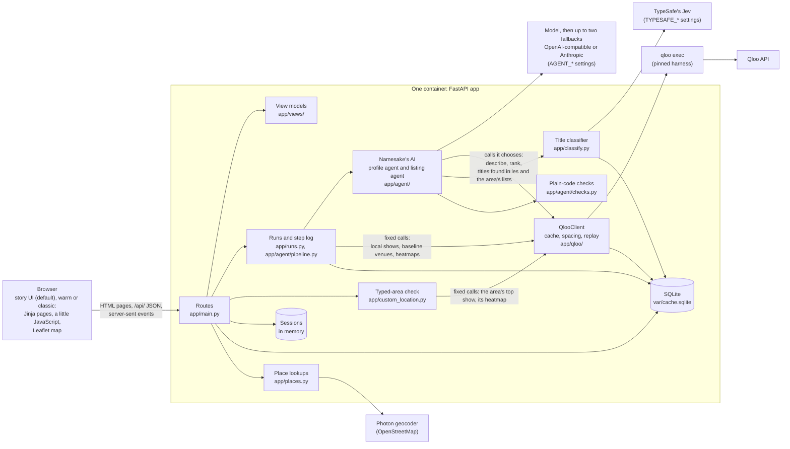
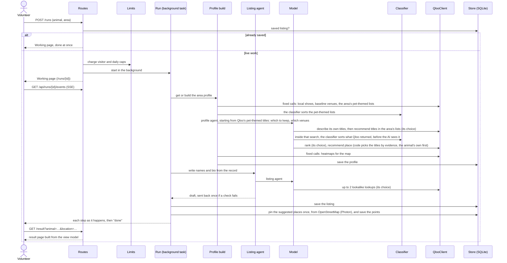
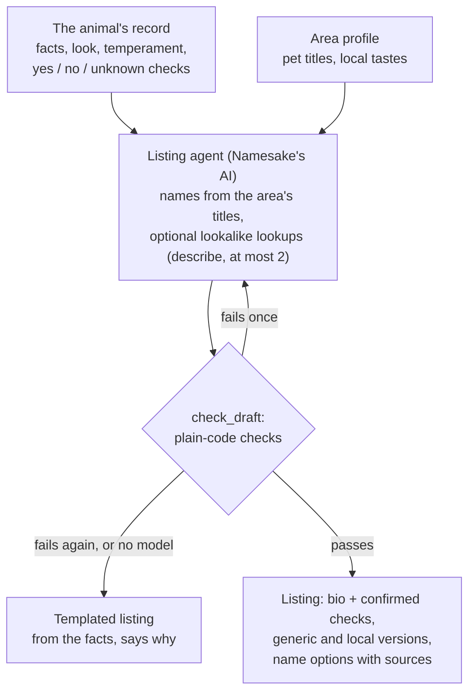
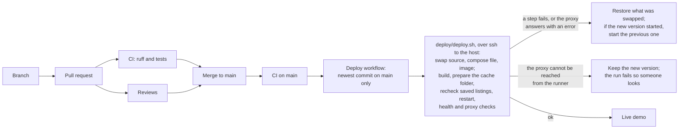

# How Namesake works

This is the technical tour: the parts, who decides what, how a request flows through them, what is stored where, and how a change reaches the live demo. The README says what the app does and why; `docs/decisions.md` records each design decision with its evidence, and `docs/qloo-findings.md` what probing Qloo showed. Qloo workflow names below (`describe`, `rank`, `recommend`, `where_popular`) are the harness's; the README's table says what each is used for.

## The parts

- **One long-lived process** serves everything: pages, the JSON API, the live step log, and the background runs. Qloo's harness is a local process with no hosted URL, so serverless was never an option.
- **Namesake's AI is two agents** (PydanticAI): a **profile agent** per area and species, and a **listing agent** per animal. Their Qloo tools are plain Python functions over `QlooClient`, so every call they make is cached and spaced like any other (decision 5).
- **A classifier sorts titles the AI finds in the area's lists** (decision 20): TypeSafe's Jev answers yes-or-no questions with a probability (pets central, dogs, cats, family audience, real people). Code keeps the clear pet titles, sets the clear others aside, and leaves the rest to the AI. It receives a title's name, kind and Qloo's description only; its answers are cached; without a key, or after a failure, the AI judges the titles itself.
- **Plain code checks everything the AI returns** before anything is saved or shown. The checks are PydanticAI output validators (`check_plan`, `check_draft`): a failed check goes back to the model with its reasons, as its one repair round. `check_plan` asks that every title and venue came from Qloo in this run, that no picked venue is screened out or a listed national chain, that a place standing out near the top or middle of Qloo's list is picked or rejected with a reason, that no title is identity-coded, and that the plan keeps each title the venues were asked for.
- **Qloo's answer and Namesake's reading stay apart.** View models carry them as separate fields, and the UI contract test checks that both render, along with the summary of each party's part on the first screen (`data-role="qloo-part"`; at the top in warm and classic, under the name options in story) (`data-role="qloo-returned"` and `"our-reading"`).
- **The UI is a replaceable skin.** Routes build typed view models (`app/views/`); a UI folder (`app/ui/<name>/`) only renders them, and the same view models are served as JSON under `/api/`. `story` is the default and tells the result as a story to two mockups (decision 24); `warm`, the default before it, and `classic` are kept for comparison (decision 21); `?ui=<name>` switches UI per request, and the contract test runs against all three. The map's basemap is a view-model piece too (`MapTiles`): CARTO's Positron and Dark Matter with the `MAP_TILES_KEY` setting (a `SecretStr`, unwrapped only where the URL is built), OpenStreetMap's tiles without, and OpenStreetMap as the fallback the scripts switch to when a keyed basemap keeps failing; story's map scripts read it from the page, warm and classic keep their OpenStreetMap layer.

## Who decides what

The hackathon asks for an agent, so this is the line that matters: where the model chooses, and where code does the same thing every time.

```mermaid
flowchart TD
    area(["The shelter's area and the animal's record"]) --> tastes
    tastes["The area's top TV shows:<br/>recommend with the area"]:::qloo --> lists
    lists["Lists for the area, asked with Qloo's pet tags:<br/>recommend, before the AI runs"]:::qloo --> sort1
    sort1["Sort each title: kept, unsure or set aside"]:::jev --> judge
    judge["Judge the unsure titles, add up to four of its own"]:::ai --> lookup
    lookup["Look its own titles up: describe"]:::qloo --> pick
    pick{"Ambiguous name?"}:::ai -- "choose a candidate, with a reason" --> search
    pick -- no --> search
    search["What fans here also like, as the AI asks:<br/>recommend with a title and the area"]:::qloo --> sort2
    sort2["Sort the results the same way"]:::jev --> rank
    rank["Order the titles for the area, as the AI asks: rank"]:::qloo --> evidence
    evidence["Keep only titles Qloo ranks or lists here,<br/>when any has that (else the AI's own, said so);<br/>pick the venue and map titles by that evidence"]:::code --> venues
    venues["Places near the shelter for their fans,<br/>in kinds that can host a stand:<br/>recommend place"]:::qloo --> compare
    compare["Compare with the places for the area's top shows<br/>(recommend place, as code asks it)"]:::code --> choose
    choose["Pick up to three places for an event or a flyer"]:::ai --> check
    check{"Every title and place from Qloo,<br/>screens passed, evidence kept?"}:::code -- "no, once" --> judge
    check -- yes --> maps
    maps["Heatmaps within the area: where_popular"]:::qloo --> lift
    lift["Lift against the top shows; a thin first map gives way"]:::code --> lookalike
    lookalike["Up to two lookalike titles, as the AI asks:<br/>describe"]:::qloo --> listing
    listing["Names from the pet titles and the area's top shows,<br/>and the bio from the record"]:::ai --> screen
    screen{"Facts traced, names screened,<br/>no shared name, length?"}:::code -- "no, once" --> listing
    screen -- yes --> pins
    pins["After the run: place the suggested venues not yet tried,<br/>with OpenStreetMap, and keep the points"]:::code --> page(["The result: Qloo's part and the AI's, kept apart"])

    classDef qloo fill:#fbe3d9,stroke:#a84526,color:#3a1a10
    classDef jev fill:#ece6f6,stroke:#6a4c93,color:#2a1d3d
    classDef ai fill:#e1efe4,stroke:#3d6b4a,color:#173020
    classDef code fill:#e8e8e8,stroke:#555555,color:#222222
```

Colours: **Qloo** answers (terracotta), **the classifier**, TypeSafe's Jev (violet), **Namesake's AI** decides (green), **plain code** decides the same way every time (grey).

| | Namesake's AI decides | Plain code does |
|---|---|---|
| **Area profile** | which unclear titles in Qloo's pet-themed lists for the area are about pets; which titles of its own to add; which of Qloo's candidates a name means, with a stated reason; which of its titles to search the area's lists with, and which unclear titles found there are about pets; the order when Qloo's ranking is unavailable; which titles to keep; which venues suit an adoption event | Qloo's pet-themed lists for the area (the four pet tags with the area as signals), sorted by the classifier, before the AI runs; leaving out titles Qloo neither ranks nor lists here when others have that evidence; sending back a plan that keeps none of the titles Qloo backs and that are established as pet-themed, or whose venues rest on titles Qloo does not back while the plan holds one it does; refusing a venue search with none of those titles; which three titles the venues and the map are asked for, by evidence (Qloo's ranking, else their best place in the area's lists, then the AI's order), never an identity-coded one, telling the AI which in `asked_for`; the area's top shows and the baseline; the baseline's venues; the venue comparison; every heatmap and the map; which titles found in the area's lists to keep or set aside, from the classifier's answers |
| **Listing** | which names to offer from the area's titles; which lookalike titles to check, and how to retry one that was refused (with whole phrases quoted from the record's look); the bio, from the facts | the answers about children, other animals, house-training and bites; the hook line; every check; per animal, skipping venues whose name or Qloo description mentions children when the record says the animal is not good with them (no Qloo call) |
| **Typed area** | nothing | the area's own top TV show (or a seed show) and the one heatmap that accepts or refuses it |

The AI reads each answer and adapts: an ambiguous title gets a choice or is dropped, a title found in the area's lists that the classifier was unsure of gets the AI's judgement, and an unavailable ranking falls back to its own order.

## A request, end to end

A volunteer picks an area (the `location` parameter in URLs) and an animal. If the result is already saved, the run finishes at once from the store; otherwise it is live work, counted against the limits first.

- **The step log** (`StepLog`) is what the Working page streams over server-sent events. Each step records who did it (`actor`: Qloo's calls and answers, a decision of Namesake's AI, the classifier, or the run's own code), given where it is logged. A follower gets every step exactly once, including those logged before it connected. A saved listing keeps its run's steps, and the story skin's result page shows them folded under "Behind this story" (`ResultView.run_steps`); a result with no listing yet offers a button that starts a run (`ResultView.write_label`, posting to `/runs`).
- **Refine** (`POST /refine`) reruns the listing with a volunteer's request, for that visitor only. **Approve** (`POST /approve`) records the chosen name and version for the measurement log. A listing for an animal a visitor added, and any refined listing, stays in their session and is never saved.

## Typed areas and the map pick

This happens before any run, when the area is not one of the presets.

- **A typed area** goes to Qloo as typed and is checked once: one heatmap, within it, for the TV show Qloo ranks highest there (the call the profile's local tastes make, so the profile finds it cached); when that list is not a plain answer, or its top show is thin there, for a seed show as well (after a `describe` of it, cached after the first time): the seed's candidates or its failure speak for the place, else the fuller map decides. Five or more cells: accepted, and the map centres on them. Fewer: "too little data here". `needs_input`: Qloo's candidates become buttons (decision 12). Text with digits is refused, which keeps street addresses away from Qloo.
- **Venue pins** (decision 4, revised): after a run saves its profile, `app/venue_points.py` looks up the suggested venues not yet tried in Photon, by name and address near the shelter (accepted only when the match carries the venue's name; else the address alone; within 12 km), paced a second apart across runs, and keeps the points on the profile, under one lock per profile shared with a run that finishes it. An outage stops the batch and counts nothing against the venues. The result map numbers the places it can frame (in a cell, or within 3 km of the shelter) as the list does; each card says which cell its place sits in, or that it is beyond the map's view, and its distance from the shelter. Never from the browser; `python -m app.venue_points` places profiles saved before.
- **Suggestions, the map search and the map pick** (decision 17) go through the app's own `/api/places` to Photon. The search above the start map (wording from `LocationForm` in the view model) only moves the map: `place-suggest.js` raises a `namesake:fly` event that `location-map.js` follows; it has no field name, so nothing from it is submitted or reaches Qloo. Suggestions ask for areas only; a picked spot is sent rounded to about 100 m, and only the areas in Photon's answer are kept. The spot becomes an area's name, and stays in the visitor's session as a pin, to about 10 m. Qloo only ever gets the name.

## The area profile

Most Qloo work depends on the area and the species, not the animal, so it is done once per area and species and shared by every animal there (decision 1). A new area and species costs about 18 to 20 Qloo calls; each further animal of that species there at most two.

```mermaid
flowchart TD
    start(["First run for an area and species"]) --> tastes["Area's top TV shows<br/>recommend tv_show with signal_location"]
    tastes --> usable{"Plain ok answer<br/>with shows left after dropping<br/>those that mention animals,<br/>a religion, race or politics?"}
    usable -- yes --> base["Baseline: the top two"]
    usable -- no --> seed["Baseline: one seed show,<br/>with a note saying why"]
    base --> basevenues["Baseline venues<br/>recommend place, baseline as signals;<br/>decides whether the kinds of place apply"]
    seed --> basevenues
    basevenues --> petlists["Qloo's pet-themed lists for the area<br/>recommend tv_show, movie, book<br/>with the pet tags and signal_location,<br/>sorted by the classifier"]
    petlists --> ai["Profile agent (Namesake's AI), starting from them<br/>look_up_title: describe<br/>find_local_titles: recommend, up to 3,<br/>sorted by the classifier<br/>rank_titles: rank, once, up to 8 titles<br/>find_venues: recommend place"]
    ai --> check{"check_plan:<br/>every title and venue came from Qloo this run,<br/>passes the screens, keeps the venues' titles?"}
    check -- no --> ai
    check -- "still no, or the AI fails" --> fixed["Fixed lookup with the seed titles"]
    check -- yes --> evidence["Code keeps only titles Qloo ranks here<br/>or lists for the area, when any has that"]
    evidence --> assemble
    fixed --> assemble["Assemble: venue comparison,<br/>heatmaps for two pet titles and two baseline shows,<br/>a third when the first is thin"]
    assemble --> lift["Map cells: mean rank of the pet titles<br/>minus mean rank of the baseline shows"]
    lift --> save[("Saved, even if unfinished")]
    save --> later{"Needs finishing?<br/>(a map or comparison missing,<br/>or a comparison today's screen rejects)"}
    later -- "yes, on a later run" --> finish["finish_profile: same titles,<br/>fixed calls only, cached ones free"]
    finish --> save
```

- **Budget**: the profile agent may make at most 20 model requests and 18 tool calls. That is a ceiling; the whole profile, fixed calls included, usually comes to 18 to 20 Qloo calls, the three pet-themed lists included, one more when the first map title is thin.
- **The kinds of place** (decision 23): both venue questions, the pet titles' and the baseline's, ask Qloo only for cafes and breweries, bookshops and pet shops, and community places (`VENUE_GROUPS` in `app/profile.py`, ten category tags), through one request builder (`venue_input`) so the agent's tool and the assembly share a cache key. The baseline's full answer decides once per area (`area_venues`, `too_few`): ok or empty with fewer than five such places, and both lists are asked for places of any kind; a failed, partial or ambiguous answer decides nothing, and the pet titles' full answer decides instead (as it does without a baseline). The profile records it (`venue_categories`), and the page says which kinds were asked for, which were not and why, labelled as Namesake's reading, and says listed national chains are left out (`chain_name`: never suggested by `venue_order`, marked by `find_venues`, sent back by `check_plan`) and Namesake's AI is asked to pass over fast food (`fast_food_mention`, advice only, said only where the AI picked). When the comparison's answer failed during the AI's run, `find_venues` has no comparison and the step log says none stand out; the assembly asks the comparison again (an error is never cached), and the cards show whatever comparison arrived.
- **Qloo's pet-themed lists** (decision 22): before the AI runs, code asks `recommend` for TV shows, films and books with Qloo's four pet tags as signals plus the area, 20 each, and the classifier sorts them. The AI starts from those; it may add up to four titles of its own, and code keeps a title only if Qloo ranks it here or lists it in one of the area's lists, whenever any title has that evidence (else the AI's own stay, and the page says so). The venues are asked for backed titles only, `find_venues` refuses a search with none of the established backed titles (ranked here, kept by the classifier, or the AI's own placed in a list), and `check_plan` sends back a plan with none of them, or with venues resting on unbacked titles while it holds a backed one.
- **Titles from the area's lists** (decision 20): `find_local_titles` asks what people around the area who like one of the AI's titles (or one the classifier kept) also like, for TV, films or books, 20 at a time, up to three searches. Titles the classifier sets aside never reach the AI's plan. Each found title keeps where it was found ("1st of 20 in Qloo's list of TV shows people around Austin who like PAW Patrol tend to like") and the classifier's answers, and the Why panel shows them in separate columns. A title listed again, or one the AI proposed that a list also holds, keeps its best place (`listed_in`), shown in Qloo's column too: that place is what orders the venue and map titles when Qloo's ranking is refused.
- **The baseline** is the area's top two shows, leaving out any whose name or description mentions animals, a religion, race or politics (decision 18: the page names them as what people here tend to watch, which must not read as a claim about who they are); the AI may not use them as pet titles. If the area's shows are unusable, one seed show stands in, with a note. If even that cannot be found, the venues and the map are left uncompared, and the note says so.
- **The heatmaps** run in this order: the first pet title, the baseline shows, then the second pet title, so a profile cut short still has a comparison. A refusal leaves a map missing, so the profile is finished on a later run; an answer with no cells, or a `needs_input` (cached and final), counts as an empty map. A first pet title with fewer than five cells within the area gives way to the next pet title when that makes a better map: more cells with a comparison, then more cells. Its heatmap is asked last (one extra call, only then), so a refusal costs only the spare; the map's caption and key say so, and that the venues are still for the titles they were asked for. The caption also counts the cells where the pet titles' fans stand out against the baseline (lift above zero, as the map colours them; a tie is cool), except on a thin map or one with no comparison. Profiles saved before this (version 2) are brought up by `app.upgrade_profiles`.
- **The map** is lift: in each cell, the pet titles' mean score minus the baseline shows' mean score. Within a neighbourhood, a heatmap's `query.affinity` is a rank spread from 0 to 1 inside the area (`docs/qloo-findings.md`), so ranks can be averaged and subtracted. Raw affinity saturates near 1.0, so it is never shown. Maps of different precision are brought to the coarsest one first.
- **Saving**: a profile is saved even if a map or the comparison is missing, and finished on a later run. Only a profile with no pet title at all is not saved; the next run tries again. A saved comparison that today's screen would not choose is finished the same way (`needs_finishing`), and until then the page does not name the show.
- **Versions**: profiles carry a version. An older one still renders as it was, except that a comparison show today's screen rejects is never named; `python -m app.upgrade_profiles` upgrades saved ones without rerunning the AI, so titles, names and listings stay valid.

## The listing

The listing agent may make at most 6 model requests and 4 tool calls. What code checks:
- **Bio**: every sentence cites recorded facts and adds no content word they lack; every recorded fact other than the look is used; at most 150 words. When the facts cannot reach 75 words, the bio stays short and the page says so; it is never padded. The answers about children, other animals, house-training and bites are added by code from fixed sentences, never written by the model, and a bite history is never softened.
- **Names**: one to three syllables, letters only; a blocklist of weapon and aggression words; a list of words that put an animal down (garbage, scat, rat and the like); a list of famous villains and tragic animals; no reference the model marks as a villain or tragic character, or as a real person; short lists of famous real people and of words coded to a religion, race or political identity; for bully-type dogs (by the look: broad or blocky head, pit bull or pit mix, pittie, staffy, bull terrier and the like), only names from the pet-themed or lookalike titles. Lists cannot be complete, so the model is also told to avoid these, and the volunteer chooses (decision 19).
- **The title behind a name**, as Qloo returned it: one about real people (a talk show, reality show, documentary, biopic, memoir, or one the classifier scores as about real people) gives only animals' names; one coded to an identity gives none, and nor does one whose own name would introduce the animal with a word that does not suit a listing (the name screen's lists plus hell, nightmare, worst, evil, horror: *My Cat from Hell*). Descriptions name the cast, so they are searched only for words that are rarely anyone's name.
- **No shared names or references**: no two animals at a shelter share a name, or what a name refers to (the title and the character, where one character's words start the other's, so "Scooby" and "Scooby-Doo" from one title are one reference and "Mr Peanutbutter" and "Mr Pickles" are two), counting listings saved before the checks last changed. A litter named as a set shares one title, never a name or a character.
- **One name per title**: an animal's options come from different titles while another of the area's titles open to it is unused. Open means a title any character's name may come from (not identity-coded, not about real people, its own name fit for a listing), and for a bully-type dog only the pet-themed ones count; lookalikes never do, so the recheck of saved drafts sees what the live check saw. A litter named as a set is the exception.
- **Hook and the names' reasons**: the hook is assembled by code from the name, its role and Qloo's title (a title ending in "!" or "?" ends the sentence); the character and role say nothing about temperament, and Qloo's title is left out of that screen, since the model did not write it. A name's reason may use only the record's look words (or be "A short name, easy to say." or a near form of it), so a cultural reference never implies how the animal behaves.
- **Lookalikes**: the shared look must be quoted from the record as whole phrases, each ending where a part of the look ends ("brindle coat", not "short"), and the name must be that animal's own (decision 14).

Saved listings carry the version of the checks they passed. When the checks change, every deploy rechecks the saved ones it can with today's rules (`app/agent/recheck.py`); one that fails, or one older than a change the recheck cannot cover, runs again when next opened (decision 16).

## Data: what is kept where

| Where | What | Shared or private |
|---|---|---|
| `var/cache.sqlite`, `qloo_cache` | every Qloo answer that is not an error, keyed by operation and canonical input | server only, never committed |
| `qloo_meta` | the time of the last live Qloo call, for spacing across processes | server only |
| `agent_results` | area profiles, listings, typed areas | server only |
| `approvals` | approved names and versions, for the measurement log | server only |
| `classifier_answers` | the classifier's answers per title, keyed by the title as described (name, kind and description), the questions and the model | server only |
| `usage` | live runs and new typed areas per day (UTC), for the daily caps | server only |
| Memory | live runs per visitor in the last hour; runs and their step logs (an hour after they finish, at most 300) | server only, reset on restart |
| `var/qloo-recordings/` | raw Qloo answers, for replay in development | never committed |
| Session (memory) | added animals, their photos and listings; refined listings; the map pin | one visitor; ends 2 hours after the last visit, on a restart, or when over 500 sessions are open |

No account exists. The session cookie holds a random ID and nothing else. Qloo receives cultural entities and place names only; Photon receives area names, rounded points, and the names and public street addresses of venues Qloo returned (to pin them, once per saved profile); the classifier receives a title's name, kind and Qloo's description; none gets anything about a visitor. `tests/test_no_qloo_data.py` fails if real Qloo data appears in the repository.

## The API

The start, result and working screens' view models are also served as JSON, so another interface can show them from the API alone; the add-animal form and the approval page are HTML only.

| Method and path | Returns |
|---|---|
| `GET /api/start?location=` | `StartView`: animals, areas, the shelter bar, examples |
| `GET /api/results/{animal}@{location}` | `ResultView`: Qloo's part and the AI's (`qloo_part`), listing versions, names, map, venues, plan, Why panel |
| `GET /api/runs/{id}` | `WorkingView`: the run's steps so far |
| `GET /api/runs/{id}/events` | the step log as server-sent events: a `step` per step with its `kind`, `text` and `actor` (`qloo`, `ai`, `classifier` or `code`, given where the step is logged), then `done` |
| `GET /api/places?q=&lat=&lon=` | area names for the typed field (ranked near the map's area) and the search above the start map (unbiased) |
| `GET /api/places/at?lat=&lon=` | the areas a picked spot lies in |
| `GET /health` | `{"status": "ok"}` |

The HTML routes render the same view models through the chosen UI: `/`, `/result`, `POST /runs`, `/runs/{id}`, `POST /refine` and `/refine/reset`, `POST /approve`, `POST /locations`, `/animals/new` and `POST /animals`, and `/photos/{animal_id}` for a visitor's own photo. `tests/test_ui_contract.py` checks that every UI renders what each screen must show, found by `data-role`: the name, Qloo's part and the AI's, Qloo's answer and Namesake's reading, the map, the photo credit and the Qloo credit, and that the note on the kinds of place carries Namesake's label. It also checks that a UI's scripts only ever fetch the app's own `/api/`.

## Configuration

Everything that differs between machines is an environment variable (`.env` locally; `.env.example` lists them). These are the app's own; the proxy settings for the server are in `deploy/README.md`.

| Setting | Default | What it does |
|---|---|---|
| `QLOO_API_KEY`, `QLOO_BASE_URL`, `QLOO_TRUSTED_BASE_URL` | none | the hackathon key and its base URL, for the harness |
| `QLOO_MIN_INTERVAL` | 5 s | the shortest gap between live Qloo calls, across processes |
| `ALLOW_LIVE_QLOO` | true | off: runs use the cache and recordings only |
| `AGENT_BASE_URL`, `AGENT_API_KEY`, `AGENT_MODEL`, `AGENT_API` | none, `chat` | the model, as configuration, never code (`AGENT_API`: `chat`, `responses` or `anthropic`) |
| `AGENT_OUTPUT_MODE` | `native` | how the model returns structured output (`native`, `prompted`, `tool`) |
| `AGENT_FALLBACK_1_*`, `AGENT_FALLBACK_2_*` (`BASE_URL`, `API_KEY`, `MODEL`, `API`, `OUTPUT_MODE`) | none, `chat`, `native` | up to two fallback models, tried in order when a run cannot reach the one before (`API` may be `anthropic`; decision 25) |
| `LIVE_RUNS_PER_VISITOR_PER_HOUR` | 6 | live runs per visitor per hour |
| `LIVE_RUNS_PER_DAY` | 60 | live runs per day, everyone together |
| `NEW_LOCATIONS_PER_DAY` | 10 | new typed areas checked per day |
| `GEOCODER_URL` | Photon's public server | empty turns suggestions, the map pick and the venue pins off |
| `TYPESAFE_API_KEY`, `TYPESAFE_BASE_URL`, `TYPESAFE_MODEL` | none, TypeSafe's API, `jev-latest` | the title classifier; without a key it is off and the AI judges the titles; an `https://` base URL only |
| `UI` | `story` | the default interface (`warm` and `classic` are kept) |
| `MAP_TILES_KEY` | none | a CARTO basemap key for the story skin's maps (Positron light, Dark Matter dark); without it, OpenStreetMap's standard tiles. It reaches the browser, where tile requests come from, so it is a public key restricted by domain in CARTO's dashboard |

## Limits and safety

- **Qloo**: the hackathon key was refused after about 12 calls in 20 minutes on 15 October (30 calls 10 seconds apart passed on 17 October), so every live call goes through `QlooClient`: cached in SQLite, spaced at least `QLOO_MIN_INTERVAL` apart across processes, with a 90-second timeout. An error is retried only when Qloo says it is retryable: once, after 5 seconds, or 20 after a rate limit; `rank`, which runs once per profile, gets a second retry with the wait doubled (40 seconds after a second rate limit) (decision 20). Pages read Qloo from the cache only; runs and the typed-area check call it live, within the caps.
- **Visitors**: live runs are capped per visitor per hour, and per day for everyone together; new typed areas per day. Place lookups have their own allowance (30 a minute per visitor, 120 for everyone), and only calls that reach Photon count. Adding an animal has one too (5 a minute per visitor), on top of three per visit; all visitors' photos together are held to 64 MB.
- **Requests**: a form body over 64 KB (and any upload over 3 MB) is refused before it is read; a POST another site's page sends (by `Sec-Fetch-Site`, or an `Origin` naming another host) is refused, so no page elsewhere can spend a visitor's run allowance. Every response carries a Content-Security-Policy (scripts and styles from the app and Leaflet's pinned copy on unpkg, tiles from CARTO and OpenStreetMap, no framing), `nosniff`, a referrer policy and `X-Frame-Options`. A missing page is the skin's notice for a browser and JSON for the API. Finished runs are kept in memory for an hour, never more than 300 in all; a run still working is never dropped.
- **The AI's own Qloo calls**: within a run, up to 8 title lookups and 3 venue searches (beyond the run's tool budget), 3 searches of the area's lists, and one ranking. A partial or degraded list of places is not picked from.
- **Classifier**: a 10-second timeout per title; any failure of Jev or its cache leaves the title to the AI, and after the first failed call a run uses saved answers only, so a slow classifier costs one timeout.
- **Model**: the per-run request and tool-call limits above, a 90-second timeout per request (one retry), 480 seconds per profile run and 300 per listing run, and one repair round. A run that cannot reach its model (an API error, a refused request, a timeout) starts again on the next configured fallback, with a step saying so (`on_each_model` in `app/agent/pipeline.py`; cached Qloo answers make the restart free of quota); a draft that fails its checks is not handed on. When no model is left, the profile falls back to a fixed lookup with the seed titles, and the listing to a templated one that says why. Each run's model usage (requests and tokens) goes to the server log.
- **Secrets** live in environment variables (`SecretStr`, never logged) and, on the server, in a `.env` with mode 600 that CI never touches. The one exception that reaches the browser is the map tile key (`MAP_TILES_KEY`): tile requests come from the visitor's browser, so the page carries it in its map JSON; it is a public basemap key, restricted by domain, and still never committed.

## Testing and delivery

- **Tests** (`uv run pytest`, about 600) never reach Qloo, a model, the classifier or Photon: they use hand-written envelopes with invented IDs (`tests/fixtures/qloo/synthetic/`, `tests/qloo_fakes.py`), PydanticAI's `FunctionModel`, a fake classifier, and a fake geocoder.
- **Reviews**: every change is reviewed by other models before it is merged (`CLAUDE.md`), and updates the docs it makes stale, this one included (AGENTS.md).

- **Hosting**: one Docker container on a VM, behind an existing Caddy (TLS), with the SQLite cache on a private volume. `deploy/README.md` covers first setup, the deploy user, upgrading profiles, and rolling back.
- **Auto-deploy**: a merge to `main` that passes CI runs the deploy from GitHub Actions, with a dedicated SSH key for a `deploy` user and the host key pinned. Only `main`'s newest commit is deployed, one deploy at a time. The server's `.env` is replaced only by a manual deploy with `--env`, never from CI.
