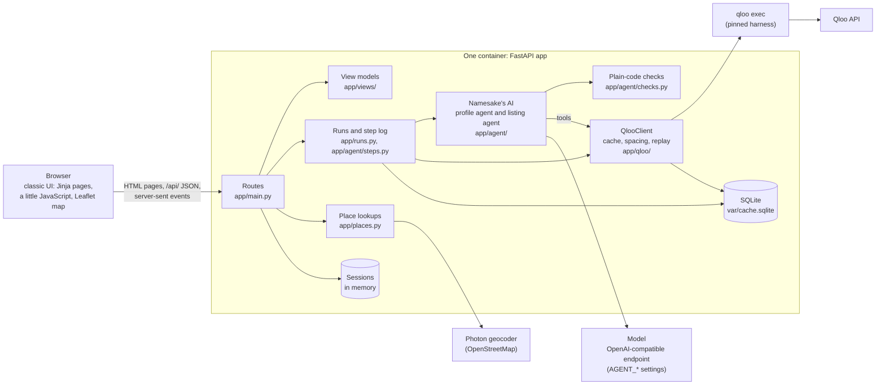
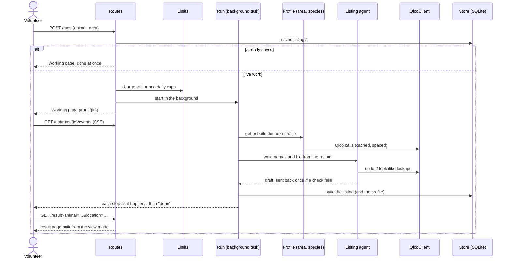
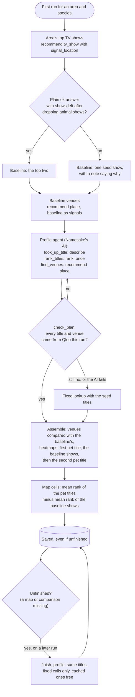
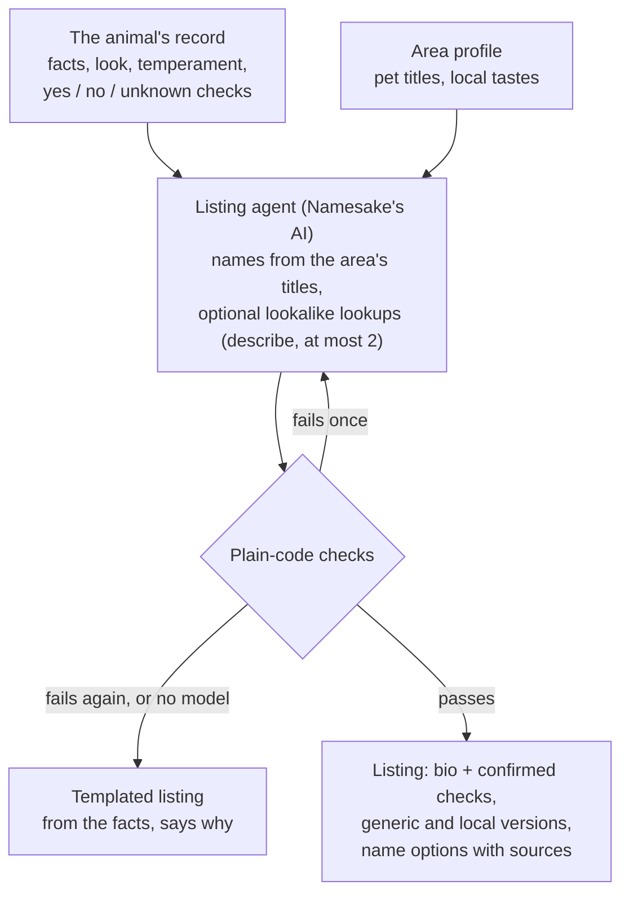
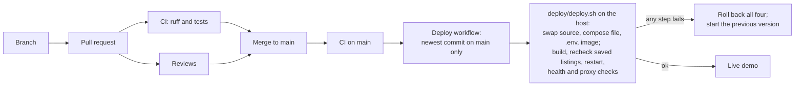

# How Namesake works

This is the technical tour: the parts, how a request flows through them, what is stored where, and how a change reaches the live demo. The README says what the app does and why; `docs/decisions.md` records each design decision with its evidence, and `docs/qloo-findings.md` what probing Qloo showed.

## The parts

- **One long-lived process** serves everything: pages, the JSON API, the live step log, and the background runs. Qloo's harness is a local process with no hosted URL, so serverless was never an option.
- **Namesake's AI is two agents** (PydanticAI): a **profile agent** per area and species, and a **listing agent** per animal. Their Qloo tools are plain Python functions over `QlooClient`, so every call they make is cached and spaced like any other (decision 5).
- **Plain code checks everything the AI returns** before anything is saved or shown: titles and venues must have come from Qloo in that run, every bio sentence must cite the animal's record, names pass a screen.
- **The UI is a replaceable skin.** Routes build typed view models (`app/views/`); a UI folder (`app/ui/<name>/`) only renders them, and the same view models are served as JSON under `/api/`. `?ui=<name>` switches UI per request.

## A request, end to end

A volunteer picks an area and an animal. If the result is already saved, the run finishes at once from the store; otherwise it is live work, counted against the limits first.

- **The step log** (`StepLog`) is what the Working page streams over server-sent events. A follower gets every step exactly once, including those logged before it connected.
- **Refine** (`POST /refine`) reruns the listing with a volunteer's request, for that visitor only. **Approve** (`POST /approve`) records the chosen name and version for the measurement log. A listing for an animal a visitor added, and any refined listing, stays in their session and is never saved.

## The area profile

Most Qloo work depends on the area and the species, not the animal, so it is done once per area and species and shared by every animal there (decision 1). A new area costs about 12 to 14 Qloo calls; each further animal at most two.

- **The AI chooses**: which pet-themed titles to try, which of Qloo's candidates a name means (with a stated reason), the order when Qloo's ranking is unavailable, which titles to send for venues, and which venues suit an adoption event. Its budget is 16 model requests and 14 tool calls per profile, with one repair round.
- **Code computes**: the baseline (the area's top two shows, leaving out any whose name or description mentions animals, and refusing them as pet titles), the venue comparison ("stands out for pet-show fans" or "popular nearby generally"), and the map.
- **The map** is lift: in each cell, the pet titles' mean score minus the baseline shows' mean score. Heatmap scores are ranks from 0 to 1 within the area, so they can be averaged and subtracted; raw affinity elsewhere saturates near 1.0 and is never used (decision 18). Maps of different precision are brought to the coarsest one first.
- **Versions**: profiles carry a version. An older one still renders as it was; `python -m app.upgrade_profiles` upgrades saved ones without rerunning the AI, so titles, names and listings stay valid.

## The listing

The checks, all in plain code:
- **Bio**: every sentence cites recorded facts and adds no content word they lack; every recorded fact other than the look is used; at most 150 words. The answers about children, other animals, house-training and bites are added by code from fixed sentences, never written by the model, and a bite history is never softened.
- **Names**: one to three syllables; a screen for villains, violent or tragic characters, weapon and aggression words, living celebrities and identity-coded references; the strictest screen for bully-type dogs; no two animals at a shelter share a name, except a litter named as a set.
- **Hook**: assembled by code from the name, its role and Qloo's title; it says nothing about temperament.
- **Lookalikes**: the shared look must be quoted from the record, and the name must be that animal's own (decision 14).

Saved listings carry the version of the checks they passed. When the checks change, every deploy rechecks the saved ones with today's rules (`app/agent/recheck.py`); one that fails runs again when next opened (decision 16).

## Typed areas and the map pick

- **A typed area** goes to Qloo as typed and is checked once before any run: one heatmap for a probe show within it. Five or more cells: accepted, and the map centres on them. Fewer: "too little data here". `needs_input`: Qloo's candidates become buttons (decision 12). Text with digits is refused, which keeps street addresses away from Qloo.
- **Suggestions and the map pick** (decision 17) go through the app's own `/api/places` to Photon: areas only, and typed text the field would refuse is never sent. A spot picked on the map is rounded to about 100 m before it leaves the browser, becomes an area's name, and stays in the visitor's session as a pin; Qloo only ever gets the name.

## Data: what is kept where

| Where | What | Shared or private |
|---|---|---|
| `var/cache.sqlite`, `qloo_cache` | every Qloo answer, keyed by operation and canonical input | server only, never committed |
| `qloo_meta` | the time of the last live Qloo call, for spacing across processes | server only |
| `agent_results` | area profiles, listings, typed areas | server only |
| `approvals` | approved names and versions, for the measurement log | server only |
| `usage` | live-run counts per visitor and per day | server only |
| `var/qloo-recordings/` | raw Qloo answers, for replay in development | never committed |
| Session (memory) | added animals and photos, refined listings, the map pin | one visitor, ends after 2 hours or a restart |

No account exists. The session cookie holds a random ID and nothing else. Qloo receives cultural entities and place names only; Photon receives area names and rounded points; neither gets anything about a visitor. `tests/test_no_qloo_data.py` fails if real Qloo data appears in the repository.

## The API

Every screen's view model is also served as JSON, so another interface can be built on the API alone.

| Method and path | Returns |
|---|---|
| `GET /api/start?location=` | `StartView`: animals, areas, the shelter bar, examples |
| `GET /api/results/{animal}@{area}` | `ResultView`: listing versions, names, map, venues, plan, Why panel |
| `GET /api/runs/{id}` | `WorkingView`: the run's steps so far |
| `GET /api/runs/{id}/events` | the step log as server-sent events (`step`, then `done`) |
| `GET /api/places?q=&lat=&lon=` | area names for the typed field, ranked near the map's area |
| `GET /api/places/at?lat=&lon=` | the areas a picked spot lies in |
| `GET /health` | `{"status": "ok"}` |

The HTML routes (`/`, `/result`, `/runs/{id}`, `POST /runs`, `/refine`, `/approve`, `/locations`, `/animals`) render the same view models through the chosen UI. `tests/test_ui_contract.py` checks that every UI renders the elements each screen must have, found by `data-role`, and only ever fetches the app's own `/api/`.

## Configuration

Everything that differs between machines is an environment variable (`.env` locally; `.env.example` lists them).

| Setting | Default | What it does |
|---|---|---|
| `QLOO_API_KEY`, `QLOO_BASE_URL`, `QLOO_TRUSTED_BASE_URL` | none | the hackathon key and its base URL, for the harness |
| `QLOO_MIN_INTERVAL` | 5 s | the shortest gap between live Qloo calls, across processes |
| `ALLOW_LIVE_QLOO` | true | off: runs use the cache and recordings only |
| `AGENT_BASE_URL`, `AGENT_API_KEY`, `AGENT_MODEL`, `AGENT_API` | none, `chat` | the model, as configuration, never code |
| `AGENT_OUTPUT_MODE` | `native` | how the model returns structured output (`native`, `prompted`, `tool`) |
| `LIVE_RUNS_PER_VISITOR_PER_HOUR` | 6 | live runs per visitor per hour |
| `LIVE_RUNS_PER_DAY` | 60 | live runs per day, everyone together |
| `NEW_LOCATIONS_PER_DAY` | 10 | new typed areas checked per day |
| `GEOCODER_URL` | Photon's public server | empty turns suggestions and the map pick off |
| `UI` | `classic` | the default interface |

## Limits and safety

- **Qloo**: the hackathon key was refused after about 12 calls in 20 minutes, so every live call goes through `QlooClient`: cached in SQLite, spaced at least `QLOO_MIN_INTERVAL` apart across processes, retried once only when Qloo says the error is retryable, with a 90-second timeout. Pages never call Qloo live; runs do, within the caps.
- **Visitors**: live runs are capped per visitor per hour and per day; new typed areas per day. Place lookups have their own allowance (30 a minute per visitor, 120 for everyone), and only calls that reach Photon count.
- **Model**: per-run request and tool-call limits (profile 16 and 14, listing 6 and 4), one repair round, then a templated listing that says why.
- **Secrets** live in environment variables (`SecretStr`, never logged) and, on the server, in a `.env` with mode 600 that CI never touches.

## Testing and delivery

- **Tests** (`uv run pytest`, about 350) never reach Qloo, a model or Photon: they use hand-written envelopes with invented IDs (`tests/fixtures/qloo/synthetic/`, `tests/qloo_fakes.py`), PydanticAI's `FunctionModel`, and a fake geocoder.
- **Reviews**: every change is reviewed by other models before it is merged (`CLAUDE.md`).

- **Hosting**: one Docker container on a VM, behind an existing Caddy (TLS), with the SQLite cache on a private volume. `deploy/README.md` covers first setup, the deploy user, upgrading profiles, and rolling back.
- **Auto-deploy**: a merge to `main` that passes CI runs the deploy from GitHub Actions, with a dedicated SSH key for a `deploy` user and the host key pinned. Only `main`'s newest commit is deployed, one deploy at a time.
